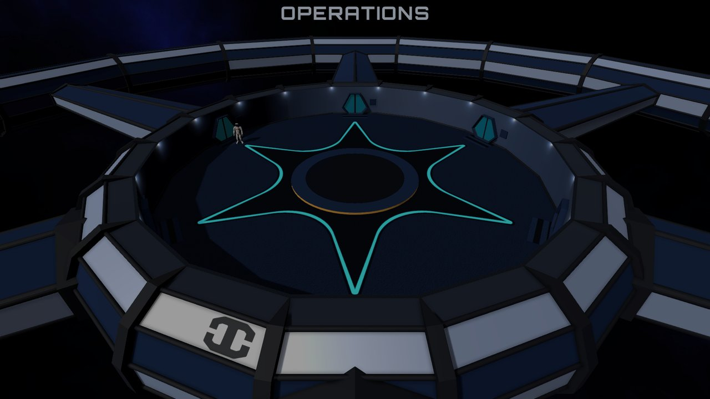
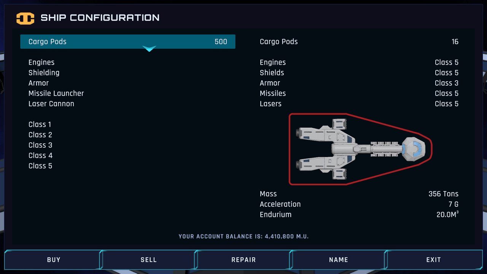
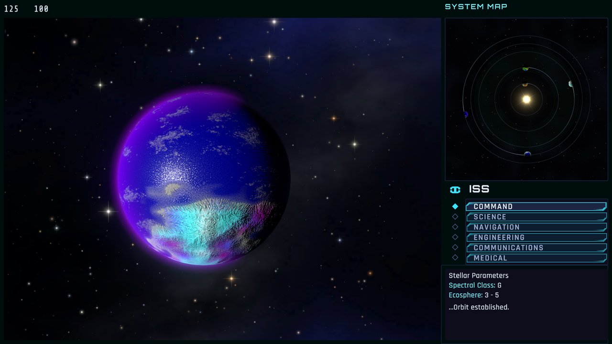

# Starflight Player's Manual

For the Unity 6 port of *Starflight*, version 1.3.0.

This manual explains how to play: the Starport, your crew and ship, flying, planets, aliens, combat and money. It tells you the story you are given at the start, and no more. What the galaxy holds, where things are and how the game is won are for you to find out.

## Contents

1. [The story so far](#1-the-story-so-far)
2. [Starting, saving and quitting](#2-starting-saving-and-quitting)
3. [Controls](#3-controls)
4. [The Starport](#4-the-starport)
5. [Your first launch](#5-your-first-launch)
6. [The bridge](#6-the-bridge)
7. [Flying](#7-flying)
8. [Planets](#8-planets)
9. [Aliens](#9-aliens)
10. [Damage, repairs and medicine](#10-damage-repairs-and-medicine)
11. [Making money](#11-making-money)
12. [How the game ends](#12-how-the-game-ends)
13. [This port and the 1986 original](#13-this-port-and-the-1986-original)
14. [Quick reference](#14-quick-reference)

---

## 1. The story so far

It is the first day of the year 4620, on the planet Arth.

The people of Arth descend from colonists who arrived long ago, in the last days of an old star-spanning empire. The colony then fell into a long dark age and lost its technology. Its founders, and the empire they came from, became legends that few believe.

Over the centuries Arth climbed back to industry, and then to slow spaceflight between its own planets. Then, not long ago, scientists broke into a vast complex buried beneath the surface, left by the first colonists. It held records, machines nobody could build any more, and a store of **Endurium**, the crystal that once drove ships faster than light.

The find made a new company, **Interstel**. Interstel has built a starship around the old designs, and it hires captains to fly it. You are its newest captain. Your Starport orbits Arth, at coordinates 125,100 on the starmap. You have 12,000 M.U. (monetary units) for a crew, equipment and supplies. Interstel pays for what you bring back:

- new worlds explored, and worlds fit for colonists;
- contact with intelligent races;
- lifeforms recorded or captured;
- alien artifacts;
- minerals, Endurium most of all.

Ships have gone out before you. Not all of them came back.

Read the notices in Operations before every launch. The first ones give your orders and a few leads close to home, and the news they bring will change your plans.

---

## 2. Starting, saving and quitting

**The first launch.** The game opens with Interstel's warning and the credits. Enter skips a page. After the last page you are in the Starport, or wherever your saved game left you.

**Save slots.** There are five save slots, A to E. The game always continues the active slot; there is no title menu. An empty slot starts a new game.

**Save Game Management.** Press Escape at any time (in the Starport or in flight) to pause and open it:

| Button | What it does |
|---|---|
| Switch | Change to another slot. An empty slot starts a new game. |
| Copy | Copy the active game into another slot. |
| Reset | Start the active slot over as a new game. |
| Colors | Pick one of 15 color schemes, each in a dark and a light mode, whether the planets are drawn in natural colors (Natural) or as they first looked in this port (Original), and how much detail the ground has when you are out in the terrain vehicle (Ground: Auto picks it for your graphics card; Low, Medium or High set it). The choices apply at once and are remembered on this computer. |
| Resume | Close the panel and play on. |
| Quit | Save and leave the game. |

Each slot shows its date, location, ship and equipment.

**Saving is automatic.** The game saves when you leave a Starport room, when you launch, every time the ship changes location in flight (into orbit, into hyperspace, onto a planet), when you close the Escape panel in flight, and when you quit. There is no "save now" button. To keep a fallback before something risky, Copy the game into a spare slot.

**Game over.** A destroyed ship is never saved. When the game is lost, "GAME OVER" appears; press Escape to return to the title screen, and the slot goes back to its last save.

**Where saves are kept.** `%USERPROFILE%\AppData\LocalLow\DefaultCompany\Starflight\` holds `SaveGame0.json` to `SaveGame4.json` (slots A to E), each with a `.bak` copy of the save before it. If a save cannot be read, the game falls back to its `.bak` copy.

---

## 3. Controls

The game is played with the keyboard.

| Action | Keys |
|---|---|
| Move, steer or point (8 directions) | Arrow keys and Home, Page Up, End, Page Down for the diagonals, or the numeric keypad |
| Pick a button on the console | Up and Down |
| Use the picked button, confirm, stop | Enter (or the keypad's Enter) |
| Pause and open Save Game Management; close the starmap or the ship's log | Escape |
| Type a name | Type it, then Enter |

- On the console, each press moves one button. Holding a key does not repeat: let go between steps.
- A console button acts about a third of a second after Enter, and only if the same button is still picked. Watch for the console changing under you, for example when an alien asks a question.
- The game starts in full screen at your desktop's resolution. To play in a window, start it from a command prompt with Unity's standard options, for example `Starflight.exe -screen-fullscreen 0 -screen-width 1600 -screen-height 900`.

---

## 4. The Starport

You walk an astronaut around the Starport's ring with the direction keys. Walk into a door and its name appears; press Enter to go in. Each room has its own buttons: the direction keys move between them and Enter uses one. Every room has an Exit.

Time stands still while you are docked. The clock only runs once you launch.

### Operations

- **Notices**: Interstel's dated bulletins. New ones are typed out for you a paragraph at a time, with time to read each one; More shows the next paragraph at once, Previous and Next page through the notices, and Quit stops one. With nothing new, it offers to repeat the last notice.
- **Evaluation**: Interstel's verdict on each planet you have recommended for colonists, one to a page.

### Personnel

The crew files. Up to 25 people can be on file.

- **Create**: pick a race with Left and Right, then name the new crew member, in up to 14 letters and with a name no one on file has. New recruits cost nothing.
- **Train**: each session costs 300 M.U. and raises one skill by the race's learning rate, up to the race's limit. Choose the number of sessions with Left and Right (Up for the most you can afford, Down for none). The dead cannot be trained.
- **Delete**: removes a crew member, also from any post they hold.
- **Previous** and **Next** page through the files.

Every crew member has five skills: **Science, Navigation, Engineering, Communications and Medicine**, and a **Durability** (how much punishment they can take). The five races are very different (see [the table in section 14](#crew-races)):

- **Humans** learn fast and are good at everything.
- **Velox** are natural navigators and engineers.
- **Thrynn** are skilled communicators.
- **Elowan** are gifted communicators and doctors, but fragile.
- **Androids** start highly skilled and never improve: their skills are hard-wired, and they cannot be trained.

### Crew Assignment

Your ship needs six officers: **Captain, Science Officer, Navigator, Engineer, Communications** and **Doctor**. Choose Assign, pick a post with Up and Down, and cycle through your crew with Left and Right. One person can hold more than one post. A crew member who has died can no longer be given a post: their file is still shown, but the post keeps its officer.

What each officer's skill does:

| Post | Skill | What it decides |
|---|---|---|
| Captain | All five | How strong your ship looks to aliens: the captain's skills count with your equipment |
| Science Officer | Science | How much the sensors' analysis tells you about planets, stars and ships |
| Navigator | Navigation | Whether your shots hit: an untrained navigator misses most of them |
| Engineer | Engineering | How fast repairs go |
| Communications | Communications | How much of what aliens say you understand |
| Doctor | Medicine | How fast wounds are treated |

A crew member of an alien race also understands every word their own people say. Some races hold old grudges against others, and they notice who serves in your crew.

### Bank

Your balance and a ledger of every payment, dated. Interstel pays 12% interest a year on the balance. It is paid when you board the ship to launch, and when you recommend a planet for colonists.

### Ship Configuration

Buy, sell, repair and name your ship.

- **Buy** and **Sell**: cargo pods, engines, shielding, armor, a missile launcher and a laser cannon. Every part but the pods comes in classes 1 to 5 (prices in [section 14](#ship-equipment)). The ship holds one of each part: sell the old one before buying another class. A part sells back for what it is worth in its condition.
- **Cargo pods**: 500 M.U. each, up to 16. Each holds 50 cubic meters. **The ship starts with none**, so it can carry no cargo until you buy some.
- **Repair**: the Starport restores the armor for 4 M.U. a point and the hull for 250 M.U. a point of its integrity, and repairs damaged equipment by the part's price and how badly it is damaged. Shields are refilled free.
- **Name**: christen the ship. It cannot launch without a name.

The right side shows what is installed, with the ship's mass, its acceleration and the Endurium aboard.

### Trade Depot

- **Buy**: Endurium (the ship's fuel), a few minerals and a few artifacts.
- **Sell**: minerals, artifacts and specimens you have brought back. The depot pays much less for a mineral than it charges for it, and prices differ a lot between minerals. Endurium sells back for its full price.
- **Analyze**: tells you what an artifact is and what it is worth. The first analysis of each artifact costs 500 M.U.; after that it is known.

You trade in tenths of a cubic meter. If you type more than you can afford, or more than the hold takes, the depot trades the most it can.

The price of Endurium is not fixed. The notices announce when it changes.

### Docking Bay

Launch from here. The crew boards, the bank pays its interest and the game saves. The ship will not launch until everything is in order. If something is missing you are told where to go:

- **Report to Operations for evaluation**: an evaluation is waiting for you to read.
- **Report to Crew Assignment**: a post is empty, or held by a crew member who has died.
- **Report to Ship Configuration to christen ship and purchase engines**.
- **Report to Trade Depot to purchase fuel**.

---

## 5. Your first launch

A new ship has class 1 engines, a bare hull, no cargo pods, no shields and no weapons, and 20 cubic meters of Endurium aboard. With 12,000 M.U. you cannot buy much, so spend it with care:

1. **Operations**: read the notices. They include leads close to home.
2. **Personnel**: create your crew. Recruits are free; training costs 300 M.U. a session, so train the skills that matter most first.
3. **Crew Assignment**: fill all six posts.
4. **Ship Configuration**: name the ship, and buy a few cargo pods so that you can bring something back.
5. **Trade Depot**: check your fuel. 20 cubic meters is enough to look around Arth's neighbourhood.
6. **Docking Bay**: launch.

Your first trips should earn money: minerals from nearby planets sell at the Trade Depot, and every planet explored and lifeform recorded pays. Better engines, shields and weapons come later.

---

## 6. The bridge

In flight the screen has the main view on the left and, on the right, a display (the System Map, Sensors, Status and others), the console, and a panel for messages under the console.

The console starts on the **bridge**: one button for each officer. Pick one to see that officer's buttons. **Bridge** takes you back.

| Bridge button | Officer's buttons |
|---|---|
| **Command** (Captain) | Launch or Land, Disembark, Cargo, Log Planet, Ship's Log, Bridge |
| **Science** | Sensors, Analysis, Status, Bridge |
| **Navigation** | Maneuver, Starmap, Raise or Drop Shields, Arm or Disarm Weapon, Combat, Bridge |
| **Engineering** | Damage, Repair, Bridge |
| **Communications** | Hail (or Respond when you are being hailed), Distress, Bridge |
| **Medical** | Examine, Treat, Bridge |

- **Cargo** lists what is in the hold, with each item's volume and value.
- **Ship's Log** keeps the Starport's notices, what aliens have told you (by subject) and the messages you have found.
- **Status** shows the date, the damage to the hull and the systems, cargo, energy, shields and weapons, with the ship's shield and armor gauges.
- **Log Planet** records the planet you are orbiting, and offers to recommend it for colonists (see [section 11](#11-making-money)).

---

## 7. Flying

### Leaving the Starport

Command, **Launch**, then **Yes**. The docking bay doors open and the ship leaves the Starport. Then Navigation, **Maneuver**.

### Maneuver

While Maneuver is active, hold a direction key and the ship flies that way at once, faster the longer you hold it. Let go and it stops. Enter ends Maneuver.

How fast the ship flies depends on its engines. Class 1 engines reach a third of the top speed of class 5 engines, and each class in between a sixth more. The ship's acceleration, shown in Ship Configuration (engines against the ship's mass), sets how quickly it gets up to that speed: a new ship takes about a second, a heavily armored one with many cargo pods several seconds. Better engines also burn less fuel (below). The game's clock keeps running while you fly, so a slow ship spends more days on a trip.

### In a star system

The main view shows the system from above and the System Map shows its star and planets. The coordinates at the top left are the system's place on the starmap.

- **Orbit**: fly close to a planet until the message panel says "Standing by to orbit", then press Enter.
- **Docking**: at Arth, the same press docks with the Starport.
- **Hyperspace**: fly away from the star, out past the edge of the system.

Flying inside a star system uses no fuel.

### In hyperspace

The coordinates at the top show where you are. Stars appear as you fly; fly into one to enter its system.

**The Starmap** (Navigation, **Starmap**, hyperspace only) pauses the game and shows the region around you. Move the cursor with the direction keys: the top line shows your position, the cursor's, the distance and **the fuel the trip needs**. Escape or Enter closes it.

### Fuel

Endurium is your fuel, and hyperspace is where you burn it: by the distance you fly. Better engines burn far less:

| Engine class | 1 | 2 | 3 | 4 | 5 |
|---|---|---|---|---|---|
| Endurium per coordinate of hyperspace | 0.48 | 0.40 | 0.32 | 0.24 | 0.16 |

Landing and launching from a planet burn fuel too, more on heavier planets. Raised shields draw on it every star hour, and every shot of your weapons uses some: a tenth of a cubic meter for a laser, half for a missile. The ship warns you as fuel runs down: "Fuel supply low", "Fuel supply critical", "Out of fuel". With none left the engines stop. Your only way home then is a distress call (see [section 11](#distress-calls)).

### Hazards of space

- **Nebulae**: shields cannot be raised inside one.
- **Stars**: Science, **Sensors** in a star system reports the star's class and its stability: stable, slightly unstable, or unstable with the Arth days left before it flares. The stability is your science officer's call: one with little skill often reports it "Not certain", so scan again or train them. A star that flares destroys any ship in its system.
- **Continuum fluxes**: notices from other captains speak of rifts in hyperspace that fling ships far across the map.

### Time

The clock runs whenever you are away from the Starport: a star hour passes every 10 seconds, so a day takes 4 minutes of play. The calendar has 10 months of 30 days, and dates are written day-month-year (`01-01-4620` is the first day of the game). Interstel's troubles will not wait for you forever.

---

## 8. Planets

### Sensors and analysis

In orbit, Science, **Sensors** scans the planet, and **Analysis** tells you what the readings mean: its surface, gravity, atmosphere, temperature and weather, and a survey of where its mineral fields and its lifeforms are. The better your science officer, the more an analysis reveals: a skilled officer finds most of the mineral fields and lifeforms and places them closely, a novice finds a few and places them roughly, and damaged sensors find less. What the officer finds is marked on the planet in the sensor picture and on the landing map. Each reading can be analyzed once: scan again for another analysis.

### Landing

1. Command, **Land**.
2. **Select Site**: move the crosshair over the planet's map with the direction keys. The coordinates show where it is. Enter sets the site. Once your science officer has analysed the planet, the map marks the mineral fields (crosses) and the lifeforms (dots) the survey found.
3. **Descend**: the autopilot takes the ship down. **Abort** cancels.

Gravity matters:

- Landing and launching each burn fuel, more the heavier the planet. **A ship without the fuel to land crashes.** Without the fuel to launch again, the ship is stuck on the surface, and only a distress call brings it home.
- **Above 7.99 G the hull is crushed on landing.**
- Once your science officer's analysis has shown a planet's gravity, Land warns you when a landing is dangerous. Pressing Land again goes down anyway.

Arth itself is off limits: dock with the Starport instead.

### The terrain vehicle

Once landed, Command, **Disembark** sends the crew out in the terrain vehicle, refuelled.

| Button | What it does |
|---|---|
| **Map** | An overhead map. Up and Down zoom; Enter closes it. |
| **Move** | Drive with the direction keys. Enter stops. |
| **Cargo** | Acts on what is next to the vehicle (see below); otherwise lists the vehicle's cargo, which you can **Drop**, or **Send** to the ship by its transporter from within 20 km. |
| **Look** | Describes the sky, temperature, gravity, atmosphere, water and terrain, and anything close by. |
| **Scan** | Reads the mineral and life density, lists the planet's elements and labels the objects nearby. |
| **Tools** | **Mine** cuts the nearest mineral deposit into the hold with the mining laser (see below). **Capture** puts a stunned lifeform beside the vehicle in stasis. **Fire** at the nearest lifeform, **Switch** between the laser and the stunner. Every shot uses some of the vehicle's fuel, the laser twice as much as the stunner. **Return** drives the vehicle back to the ship by itself. |

The vehicle's status display shows its fuel, its efficiency, how full its hold is, the crew's health and **the ship's distance and direction** from you.

**Cargo** acts on the first of these that is next to the vehicle:

- **Ruins**: records any message they hold in the ship's log, and takes anything that can be carried.
- **Cargo you dropped**: picks it up again.
- **A lifeform**: **Record** its data, or **Ignore** it. To capture a living one into stasis, stun it first, then use Tools, **Capture** beside it (a dead lifeform can only be recorded).
- **A mineral deposit**: names it and how much it holds. To take it, use Tools, **Mine**.

**Mine** aims the mining laser at the nearest deposit within reach and cuts it into the hold a tenth of a cubic meter at a time, on the vehicle's fuel. A deposit holds between 1.0 and 9.9 cubic meters, and the largest takes about seven seconds. The laser stops when the deposit is gone, when the hold is full or the fuel runs out, or when you press Enter; what is left of a deposit stays for your next visit.

The vehicle's hold takes 50 cubic meters.

### Getting back

Drive back to the ship and stop beside it, within half a kilometer, to go back in at once. Stop anywhere else within 3 km of it on your way back and the crew asks "Return to the ship?": **Yes** takes you in, **No** keeps you out to go on exploring. Or use Tools, **Return**: the vehicle drives itself back and goes aboard beside the ship. It stops short of lava in the way, or when something blocks it, and Enter stops it too. The vehicle is refuelled and everything in its hold moves into the ship's cargo pods. Then Command, **Launch**, **Yes** takes the ship back into orbit.

### Hazards on the surface

- **Fuel**: every kilometer costs fuel by the ground you drive on: little on low ground, more on high ground, and about seven times as much on a liquid. Below 0% the tank still has a small reserve. If the vehicle runs dry, the crew walks back to the ship, the cargo stays behind, and the longer the walk the likelier someone is hurt on the way.
- **Storms**: the weather can change every star hour, and the wilder the planet's weather the more often a storm comes. Rain, fog and snow make every kilometer cost more fuel and a storm twice as much. A storm can injure the crew, and storms and heavy snow hide the bearing to the ship unless your navigator is highly skilled.
- **Lava**: drive off molten ground at once. After a few seconds in lava the vehicle and its cargo are lost. The crew gets back to the ship, and the Starport fits a new vehicle for a 10,000 M.U. fine.
- **Lifeforms**: some are harmless and some flee, but dangerous ones come at the vehicle and attack the crew. The laser kills; the stunner only stuns.

---

## 9. Aliens

### Encounters

Alien ships move around the galaxy, and the radar shows them coming. When they close in, the ship drops into an **encounter**: you, them and the space around you. Some groups guard planets instead, and meet you when you go into orbit there.

To leave an encounter, fly out of its area. Once you are clear, a minute passes before anyone else can stop you.

In an encounter, Science, **Sensors** moves a ring over the ships with the direction keys; Enter scans the one under it. **Analysis** then tells you what it is, its size, and whether its shields are up and its weapons armed. Your crew also tells you when aliens raise their shields or arm their weapons.

### Communications

1. Communications, **Hail**, or **Respond** if they are calling you.
2. Choose a posture: **Friendly**, **Hostile** or **Obsequious**.
3. Once the link is up: **Statement**, **Question**, **Posture** (change it) or **Terminate** (end the link).
4. Questions are on one of five subjects: **Themselves, Other Races, Old Empire, The Ancients, General Info**.

Aliens may ask you questions too. The console then offers **Yes**, **No** and **Terminate**: answer with care.

Some things to know:

- Every race has its own temper. Your posture, your shields and weapons, the strength of your ship and what you say all change how they treat you. A stronger ship gets more respect.
- Aliens hold their fire while a comm link is up.
- Fire on aliens and they will not talk to you again in that encounter.
- How much you understand depends on your communications officer.
- What they tell you is kept in the Ship's Log, under Alien Comms. Much of the game's story is told this way: listen.

### Combat

1. Navigation, **Raise Shields** (you need shielding, and fuel). Shields keep their charge when dropped. In an encounter they regain 20 points on each of your ship's turns (the more alien ships, the longer between turns), whether raised or not, and they are full again when the encounter ends.
2. Navigation, **Arm Weapon** (you need a laser cannon or a missile launcher).
3. Navigation, **Combat**: **Target** picks the next ship and shows its range; **Laser** and **Missile** fire at it; **Status** shows your shields and armor.

| Weapon | Range | Damage, class 1 to 5 | Notes |
|---|---|---|---|
| Laser | 800 | 90, 210, 360, 510, 660 close up | Weaker with distance, nothing at 800; fast to recharge |
| Missile | 1500 | 200, 400, 700, 1000, 1500 | The same at any distance; homes in on the target |

- Weapons need no ammunition, but every shot burns Endurium: a tenth of a cubic meter for a laser, half for a missile. Damaged weapons do less damage.
- Whether a shot hits depends on your navigator: a well trained one rarely misses, an untrained one rarely hits.
- Alien lasers hit twice as hard as yours, and aliens open fire only once they are close.
- Hits on you go to your shields while they are up, then to your armor. Only once the armor is gone do they reach the ship itself: each part of a hit lands on the hull, one of the systems or the crew. "Hull breach imminent" means your armor is almost gone. **The ship is destroyed when its hull's integrity reaches 0**; without armor it fights on, but every hit hurts.
- Alien missiles fly to where your ship was when they were launched: keep moving and they miss.
- Aliens' shields protect them only while raised, and not inside a nebula.
- Some races give up when the fight goes badly for them.
- A destroyed ship leaves wreckage. Fly over it to salvage what it carried.

---

## 10. Damage, repairs and medicine

**Damage** (Engineering): a bar for the hull's integrity and for each system: engines, sensors, communications, shields, missile launcher and laser cannon. A damaged system works only as well as its health, and it can break down when you use it: each time you scan, hail, talk, maneuver, land, launch from a planet, raise the shields or arm the weapons, a damaged system can malfunction, with a chance as large as its damage (a system at 70% fails 3 times in 10, one at 0 every time). A system that has malfunctioned is inoperative until it is repaired: the engineer's repair ends it when the system is whole, and past 73% each repaired point may bring it back sooner. Repair's report on a system says whether it is operative. Engines shot down to nothing break down at once, so keep the engineer and some minerals aboard.

**Repair** (Engineering): pick what to repair with Up and Down, and Enter. The engineer asks for the minerals the repair needs, taken from your cargo. Repairs take time, faster with a better engineer. The engineer repairs the hull and the systems, never the armor: only the Starport restores the armor. A destroyed system cannot be repaired in space: the Starport's Ship Configuration room can.

**Examine** and **Treat** (Medical): pick a crew member with Left and Right, and Enter. Examine shows their wounds and vitality. Everyone on board heals slowly by themselves. Treat makes one crew member the doctor's patient, who heals twice as fast (but not on a planet's surface), and a better doctor makes everyone heal faster.

**Crew deaths**: a crew member whose vitality reaches 0 dies, and the dead are beyond help. Their posts go to the crew members best at them, and if the captain dies the science officer takes command. Before the next launch you must fill the dead officer's post.

---

## 11. Making money

- **Minerals**: load deposits with the terrain vehicle, bring them home and sell them at the Trade Depot. Prices differ a lot between minerals.
- **Artifacts**: found in ruins. Analyze them at the Trade Depot and sell them, or keep them: some are worth more aboard than their price.
- **Lifeforms**: recorded data is paid when you dock. Captured specimens are sold at the Trade Depot, for several times the value of their data. Each new kind is worth the most.
- **Colonies**: in orbit, Command, **Log Planet**, then **Yes** to recommend the planet for colonists, and give it a name (up to 15 letters). A good world earns a bonus; a poor one earns a fine, larger each time. The verdicts are in Operations, under Evaluation.
- **Interest**: 12% a year on your balance.

### Distress calls

Communications, **Distress**, then **Yes**, calls Interstel to tow the ship home to the Starport. It works anywhere but in an encounter (the aliens jam it) and at the Starport. The towing fine is at least 15,000 M.U. and grows with the distance from Arth, with no upper limit. Back at the Starport after a tow, or after losing the terrain vehicle, report to Operations first: Interstel's evaluation comes up there by itself, and until you have seen it the other rooms stay shut and the ship cannot launch.

---

## 12. How the game ends

Interstel wants to know why stars are flaring, and to stop them. How is for you to find out.

The game is lost when:

- the ship is destroyed, in combat, by a flaring star, or in a bad landing;
- the whole crew has died;
- time runs out for Arth.

---

## 13. This port and the 1986 original

This is a faithful remake of *Starflight* (Binary Systems, Electronic Arts, 1986), rebuilt in Unity 6. The 270 stars and their planets, the prices, the aliens' words and the game's rules all come straight from the original game and its code. What the port adds:

- 3D views: real planets and stars (the planets in natural colors with skies and clouds, if you like), a 3D Starport and terrain;
- a new console and Starport design, in 15 color schemes;
- lifeforms on the planets' surfaces rebuilt from the game's 1984 design notes;
- a survey from orbit: the science officer's analysis marks a planet's mineral fields and lifeforms on the landing map and the sensor picture, and its ruins with the Red Cylinder aboard;
- an easier terrain vehicle: a mining laser in place of the original's one-press pickup of a deposit, a Return order, a transporter for its hold, and boarding anywhere within 3 km of the ship;
- grass, pebbles and finer ground around the terrain vehicle, as much as the Colors screen's ground detail asks for.

Known differences:

- **Flight**: the ship's top speed follows its engines (class 1 at a third of the original's, class 5 at all of it); in the original every ship flew at the same speed.

---

## 14. Quick reference

### Crew races

| Race | Starting skills (Sci / Nav / Eng / Com / Med) | Highest skills | Learning rate | Durability |
|---|---|---|---|---|
| Human | 50 / 30 / 30 / 30 / 30 | 250 / 200 / 200 / 200 / 200 | 9 | 6 |
| Velox | 30 / 50 / 50 / 0 / 0 | 200 / 250 / 250 / 100 / 100 | 6 | 8 |
| Thrynn | 30 / 30 / 30 / 50 / 0 | 200 / 200 / 200 / 250 / 100 | 7 | 6 |
| Elowan | 10 / 30 / 10 / 50 / 50 | 150 / 200 / 150 / 250 / 250 | 10 | 2 |
| Android | 50 / 150 / 100 / 0 / 20 | cannot be trained | 0 | 10 |

### Ship equipment

Prices in M.U., to buy, class 1 to 5. An undamaged part sells back for a little less.

| Part | Class 1 | Class 2 | Class 3 | Class 4 | Class 5 |
|---|---|---|---|---|---|
| Engines | 1,000 | 8,000 | 20,000 | 40,000 | 100,000 |
| Shielding | 4,000 | 12,000 | 32,000 | 70,000 | 125,000 |
| Armor | 1,500 | 3,100 | 6,200 | 12,500 | 25,000 |
| Missile Launcher | 12,000 | 28,000 | 60,000 | 120,000 | 200,000 |
| Laser Cannon | 8,000 | 20,000 | 54,000 | 90,000 | 150,000 |
| Cargo Pod | 500 each, up to 16, 50 cubic meters each |

### Starport services

| Service | Price |
|---|---|
| Training | 300 M.U. a session |
| Armor repair | 4 M.U. a point |
| Hull repair | 250 M.U. a point of its integrity |
| Artifact analysis | 500 M.U., once for each artifact |
| Endurium | 1,000 M.U. a cubic meter at the start of the game |
| A new terrain vehicle after one is lost | 10,000 M.U. |
